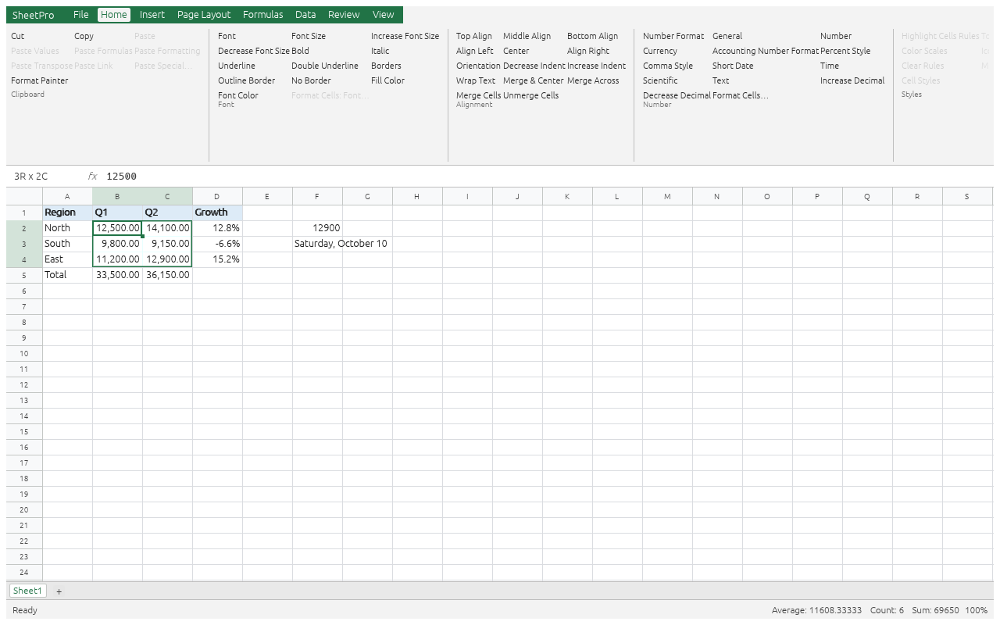

# SheetPro

An open-source, clean-room reimplementation of a desktop spreadsheet application, written
in Rust. Feature target: Microsoft Excel (same ribbon commands, shortcuts, worksheet
functions, calculation results and `.xlsx` fidelity).

> SheetPro is not affiliated with, endorsed by, or sponsored by Microsoft. "Microsoft" and
> "Excel" are trademarks of Microsoft Corporation, used here only to describe compatibility.



## Status

Early. See [`docs/roadmap.md`](docs/roadmap.md) › *Honest parity assessment*,
[`docs/scorecard.md`](docs/scorecard.md) and [`docs/parity.md`](docs/parity.md).

## Quick start

```sh
cargo run -p sheetpro                    # desktop app
cargo run -p sp -- eval "=PMT(5%/12,360,-250000)"
cargo run -p sp -- control               # JSON-lines automation on stdin/stdout
cargo xtask check                        # all gates
```

Contributors and AI agents: read [`AGENTS.md`](AGENTS.md) first.

## License

MIT OR Apache-2.0.
